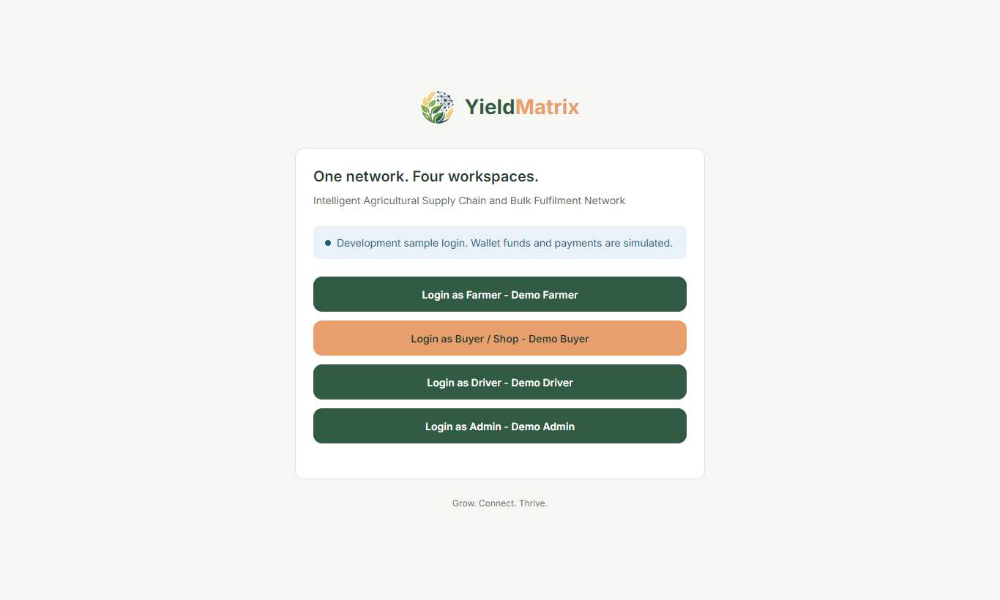
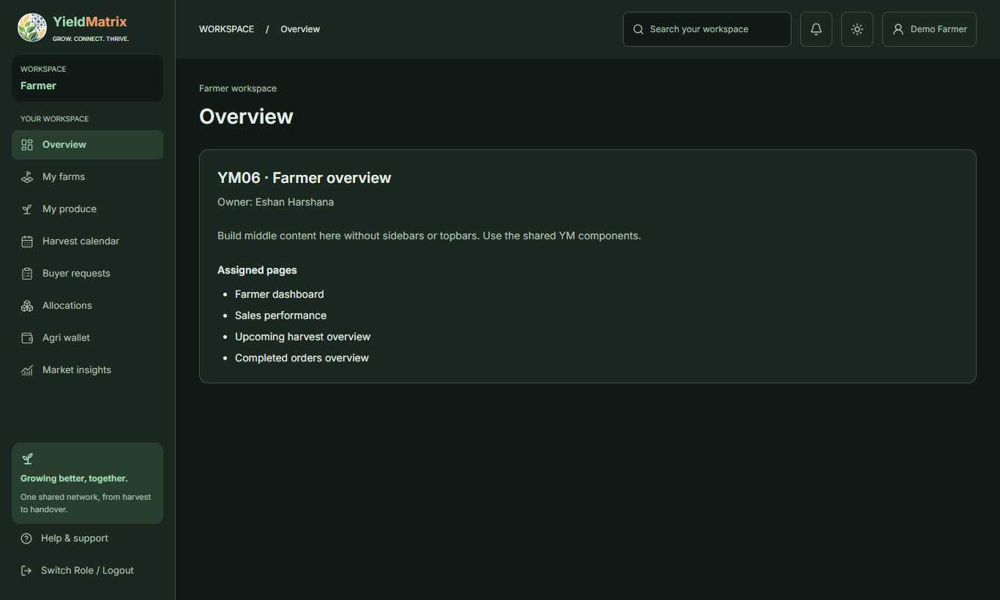

# YieldMatrix

**Intelligent Agricultural Supply Chain and Bulk Fulfilment Network**

A shared development base for 32 teammates, with separate workspaces for farmers, buyers, drivers and admins.

Built with React, TypeScript, Tailwind CSS, Express and PostgreSQL.

## Preview

**Sample login**



**Farmer workspace in dark mode**



The base includes demo login, role guards, shared UI components, navigation and dark mode. Module pages are placeholders. Trading features, AI and blockchain work are still to be built.

## Run on your laptop

Install Node.js 22 or 24 and Git. npm comes with Node.js. Open the project in VS Code or your preferred editor.

Clone the team's GitHub repository, then open its folder. Replace `<repository-url>` with the URL shared by the team.

```bash
git clone --branch development <repository-url> YieldMatrix
cd YieldMatrix
```

### 1. Start the backend

Open a terminal in the project root:

```bash
cd backend
npm install --package-lock=false
```

Copy `backend/.env.example` to `backend/.env`. Keep an existing `.env` if you already have one. The example settings are enough for local demo login. Never commit your `.env` or database password.

```bash
npm run dev
```

Leave this terminal running. The API starts at `http://localhost:5000`.

### 2. Start the frontend

Open a second terminal in the project root:

```bash
cd frontend
npm install --package-lock=false
npm run dev
```

Open [localhost:5173/login](http://localhost:5173/login). Choose Demo Farmer, Demo Buyer, Demo Driver or Demo Admin. No password is needed for these development accounts.

On Windows, use `npm.cmd` instead of `npm` if PowerShell blocks the command.

## Connect the database

Demo login and workspace navigation work without a database. Database-backed APIs need these steps:

1. The database maintainer runs [schema.sql](backend/database/schema.sql), then [seed.sql](backend/database/seed.sql), in the Neon SQL Editor for the agreed development database.
2. Each developer puts the supplied Neon connection string in `DATABASE_URL` inside their own `backend/.env`.
3. Restart the backend after changing `.env`.

The seed includes demo accounts, simulated wallets, crops, grades and a sample farm. Each backend uses a pool with a maximum of two connections. Database credentials belong only in the backend.

Agree on shared table changes before applying them. Editing `schema.sql` does not update tables that already exist.

## Project structure

```text
frontend/src/
  assets/            Shared logo
  components/        Button, InputField, ContentCard and other shared UI
  context/           Login state
  features/
    auth/            Sample login page
    ym01/ ... ym32/  Each teammate's pages and local routes
  layouts/           Shared sidebar, topbar and Outlet
  services/api.ts    Backend requests and login token
  App.tsx            Main route mapping

backend/
  database/          Schema and sample data
  src/
    config/db.js     Shared PostgreSQL connection pool
    middleware/      Login and role checks
    modules/
      auth/          Demo login API
      ym01/ ... ym32/  Each teammate's routes and controllers
    server.js        API setup and module mounts

ai-service/          FastAPI health endpoint; Week 2 placeholder
blockchain/          Week 2 placeholder
```

## Work on your module

Create your own branch from the latest `development` branch. Example for YM07:

```bash
git switch development
git pull --ff-only origin development
git switch -c ym07/farm-management
```

- Build pages inside `frontend/src/features/ym07/`. Connect new pages through that module's `index.tsx` and local routes. Adding a file alone does not make it visible.
- Build only the middle content. The shared layout renders your module through `<Outlet />` beside the sidebar and below the topbar.
- Import shared components directly, such as `../../components/Button`. Their props include editor hints.
- Use `../../services/api` for frontend requests. For example, `api.get('/ym07/status')` calls `/api/ym07/status` with the login token.
- Add API paths in your module's `routes.js`. Put request handling and parameterised database queries in `controller.js`, using the shared pool from `../../config/db.js`. There is no separate service or model layer yet.
- Protect new APIs with login, role and record ownership checks. Hiding a button is not an access check.

The `/status` endpoint is a database-backed example, not a finished feature API. Keep changes inside your assigned folders where possible. Coordinate changes to shared components, routes and database tables with the team.

Push your branch and open a pull request into `development`.

## Check before sharing

From `frontend/`:

```bash
npm run typecheck
npm run build
```

Try your page through the sample login. Check its menu link, light and dark mode, and a narrow screen. After logout, workspace URLs should return to login. A user opening another role's workspace should return to their own overview.

AI and blockchain services are not required to run the current base.
